# Fooocus-Qwen-Image-2.1

**English** · [Русский](README.ru.md)

A [Fooocus](https://github.com/lllyasviel/Fooocus)-style studio for the local
[Qwen-Image-2.1](https://huggingface.co/Qwen/Qwen-Image-2.1) model: one prompt
line, one **Generate** button, and everything else behind **Advanced**. It
generates images from text, edits them by instruction — with a mask brush,
colour annotations or an exact region — extends the canvas, and takes up to ten
reference images. Everything runs on your own GPU — from a 24 GB desktop card
down to an 8 GB laptop.

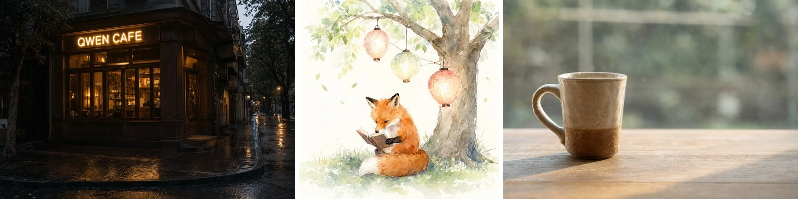

<sub>All three images were made with the MiddleQuality preset (1536 px, 28 steps) straight from a plain prompt. The neon sign text is rendered by the model itself.</sub>

## Contents

- [Features](#features)
- [A tour of the interface](#a-tour-of-the-interface)
- [Requirements](#requirements)
- [Which settings for my card](#which-settings-for-my-card)
- [Installation](#installation)
- [Running](#running)
- [Usage guide](#usage-guide)
- [Performance](#performance)
- [Privacy and security](#privacy-and-security)
- [Project layout](#project-layout)
- [Development](#development)
- [License](#license)
- [Acknowledgements](#acknowledgements)

## Features

- **Text to image** with nine quality choices, from a 5-second draft to 2K:
  the full model at 16, 28 or 40 steps; the official **Qwen Turbo**
  checkpoint at 8 steps for 1024, 1536 and 2048 px (2K in under a minute on
  an RTX 3090); and the distilled **Turbo** (6 steps at 1 MP), **Draft** (the
  same at 768 px) and **Turbo4** (4 steps, the fastest on 8 GB cards). Seven aspect ratios, 277 Fooocus styles, up to eight
  images per run.
- **Runs on 8 to 24 GB cards**: the transformer in bf16, INT8 or GGUF (13.3
  down to 2.7 GiB of VRAM), a memory profile picked by the card, and optional
  SageAttention (15–25% faster steps). The installer proposes what fits your
  card; switch later in Settings, where every option states what it costs.
  Missing weights download with a progress bar.
- **LoRA**, as in Fooocus: five slots with on/off, file and weight, on both
  tabs. Each file is checked before use — LoRA made for Qwen-Image 1 / 2512 /
  Edit, FLUX or SDXL are flagged instead of silently doing nothing — and all
  common Qwen-Image-2.1 formats load, including the ComfyUI / ai-toolkit fused
  `gate_up` that diffusers' own loader drops. Trigger words are shown, and
  LoRA names, weights and hashes go into the PNG.
- **Reference images**: up to ten, each addressed in the prompt as
  `<image1>`…`<image10>`. Any cell can take a **pose** — from a pose library
  or recognised from your own photo — or a hand-drawn **sketch**.
- **Any image format in**: HEIC from phones, camera RAW (DNG, CR2/CR3, NEF,
  ARW, RAF, ORF…), TIFF 16-bit, PSD, JPEG XL, AVIF, EXR, SVG and more — dropped
  as is, converted to sRGB PNG on the way in. See [Image formats](#image-formats).
- **Instruction-based editing** in four region modes:
  - **Mask** — paint the area to change; every pixel outside it stays byte-for-byte intact.
  - **Annotation** — circle several areas in different colours and describe each change by its colour in one prompt.
  - **Exact region** — edit a crop around the mask at full detail, then paste it back.
  - **No region** — edit the whole frame.
- **Outpainting in one click**: pick a side or a target aspect ratio and press
  **Extend** — the picture grows with a seamless continuation, the original
  pixels pasted back untouched. An outpaint LoRA keeps the picture in place;
  no mask, no second step, the prompt is optional.
- **A responsive mask brush** with size, eraser, undo/redo, zoom, pan, lossless crop,
  clipboard paste and touch support. Stroke cost stays constant — no lag on
  4K images (the stock Gradio editor's strokes slowed from 16.7 to 44 ms per
  move on a long stroke).
- **AI boost**: an external OpenAI-compatible language model (llama.cpp, vLLM,
  LM Studio) rewrites short prompts into detailed ones, using the official
  Qwen rewriting prompts. It also works with text-only models.
- **Saved prompts** right under the prompt field on both tabs: pick one to
  load it, type a name and save, delete. Ships with **Upscale**, a
  restoration prompt for the Edit tab: a higher resolution, corrected gamma
  and white balance, faces left exactly as they are.
- **Gallery** with each image's parameters stored inside the PNG: reuse them,
  send the image back to the editor, or restore parameters from any PNG file.
- **Video with sound** (MiniMax H3 through the
  [FreeVideo](https://github.com/FlashML-org/FreeVideo) engine, from 8 GB of
  VRAM): text to video, first frame to video, first and last frame, and
  references (up to 9 images, 3 videos, 3 audio clips for characters, style
  and voice). Duration in seconds up to a minute; drafts that finish without
  regenerating; "last frame → next shot"; and a **storyboard** that splits a
  brief into shots, films them in a chain and joins them with transitions.
  Images go to the Video tab with one button. See [Video](#video).
- **Bilingual interface** (English / Russian), switchable at any time.
- **HTTP API** (`--api`): everything the interface does — generate, edit,
  outpaint, poses, AI boost, gallery, settings — as JSON calls with a job
  queue and progress, protected by a Bearer token. The interface itself can
  ask for a login and password. See [docs/API.md](docs/API.md).
- **Careful with video memory**: on 24 GB the models take turns on the card
  whole; on 8 GB the transformer stays put while the text encoder, compressed
  to INT8, is lifted onto the card one layer at a time. Prompt embeddings are
  cached and the VAE decodes in tiles without seams.

## A tour of the interface

### Generate

Type a prompt, pick a line in **Quality and speed** and press **Generate**.
The list on the right runs from the fastest choice to the best, and each line
says its steps and image size. With **AI boost**
on, the prompt is first rewritten by your language model. **Rewrite now**
shows the rewritten text before you generate, so you can review or edit it.
Whatever is in the *Rewritten prompt* box is what the model receives.
**Send to editor** puts the selected result into the mask brush and opens the
Edit tab; **Send to references** puts it into the first free reference cell. Both buttons
also sit under the Edit tab's result. Click the result (or a filled reference
cell) to view it full size: click again for 100%, drag to pan, arrow keys for
the other results, Esc to close.

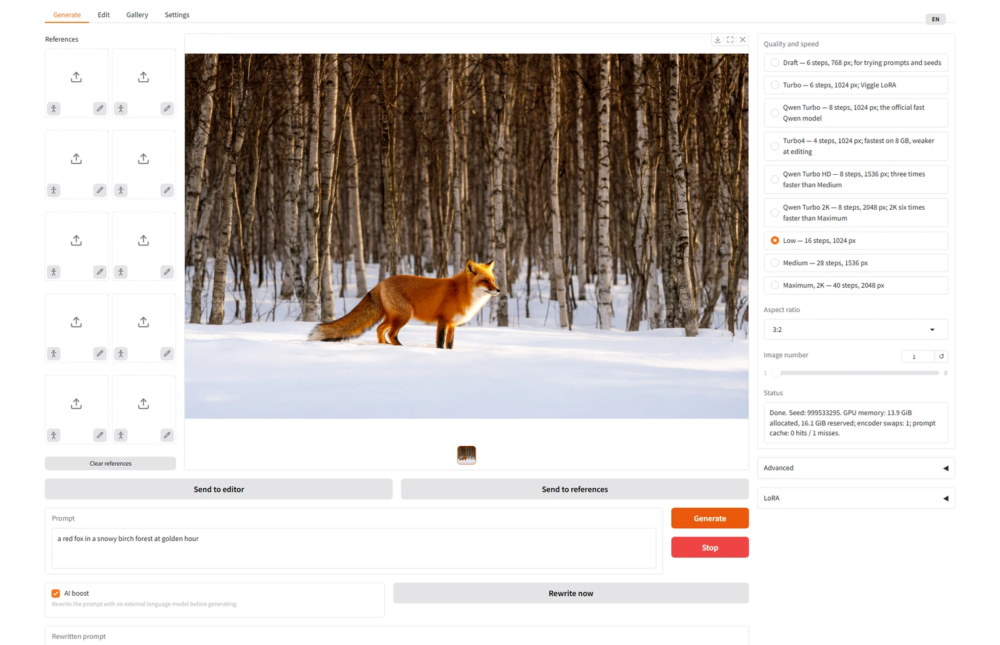

Each reference cell has two small icons in its bottom corners. The figure
opens a pose library: pick a pose and its OpenPose skeleton goes into the
cell, and the model follows it.

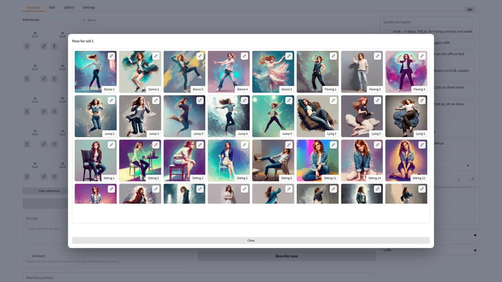

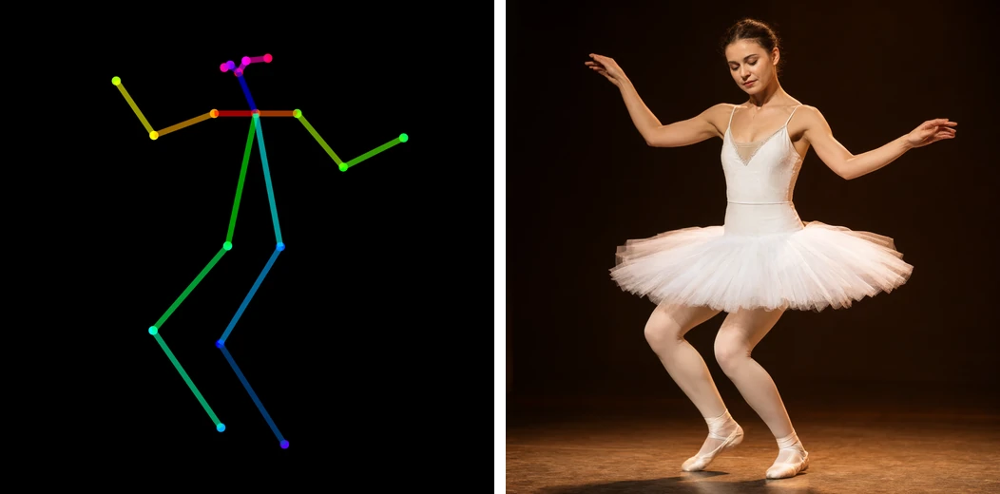

The pencil opens a sketch canvas: draw, press **Accept**, and the sketch
becomes the reference.

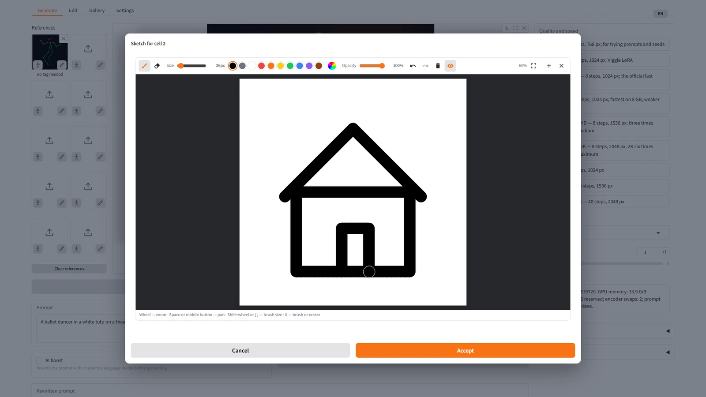

### LoRA

Open **LoRA** under *Advanced*, pick a file in a slot and set its weight.
The line under the slot shows the rank, the number of layers and trigger
words, or why the file won't be applied.

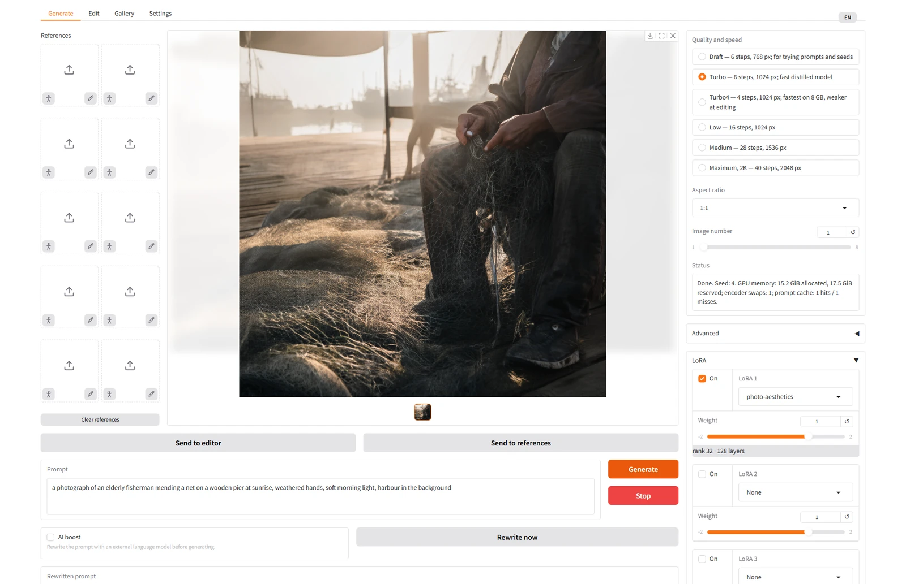

The same prompt and seed on Turbo, without and with
[SimpleTuner's photo-aesthetics LoRA](https://huggingface.co/SimpleTuner/Qwen-Image-2.1-LoRA-photo-aesthetics-v2):


### Edit with a mask

Paint over the area to change and describe the change. Only the painted area
is regenerated; the rest of the image is kept exactly. On wide screens the
brush and the result sit side by side.

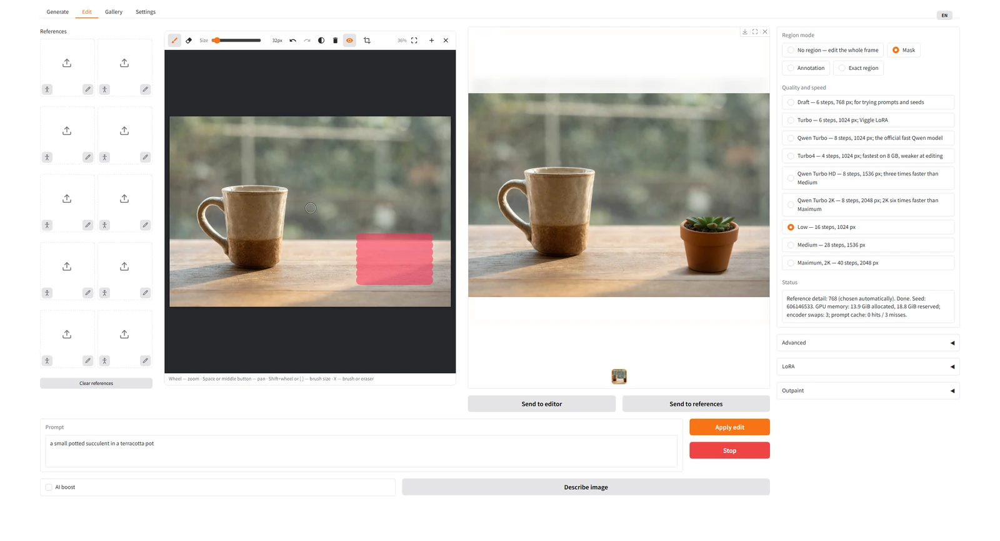

Before and after — *“a small potted succulent in a terracotta pot”*:


### Edit several areas at once with annotations

Circle areas in different colours and refer to them by colour in one prompt.
This makes several independent edits in a single pass.

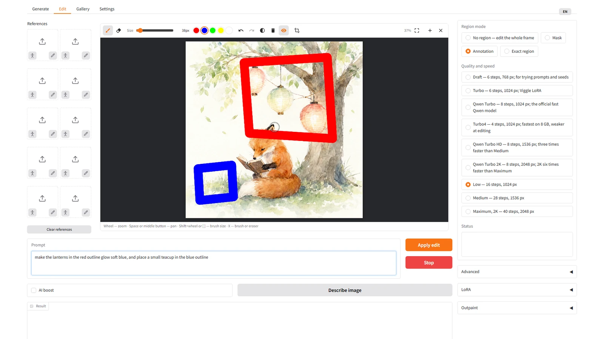

*“make the lanterns in the red outline glow soft blue, and place a small teacup in the blue outline”*


### Outpaint

Open **Outpaint**, pick a target aspect ratio (or sides and how far) and press
**Extend**: the extended picture appears right away, with your original
pasted back pixel for pixel. The prompt is optional — it says what should
appear in the new area.

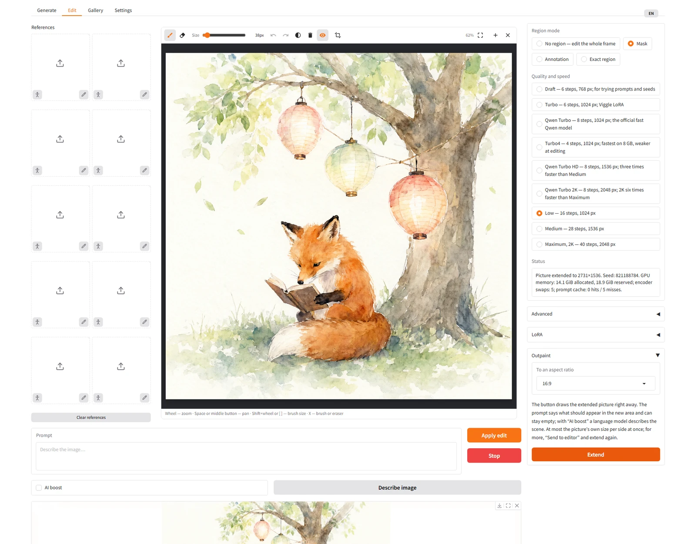

A square watercolour extended to 16:9 in one click:


### Video

MiniMax H3 makes video and sound in one pass. Pick a mode, describe the scene
(in any language — **AI boost (H3 format)** rewrites it into the structure H3
was trained on), set the duration and press **Make video**. Below the slider
you see what you get: `864×480 · 124 frames · 5.17 s`. A **Draft** renders the
first pass at half size; **Finish the draft** completes the same video
without starting over. The **Storyboard** accordion turns a brief into editable
shots, films them so each starts from the previous shot's last frame, and
joins them with cuts or dissolves at a level loudness, with a contact sheet
for review. **To video** under any generated or edited image sends it to this
tab.

### Gallery

Each result is saved with its parameters inside the PNG. Select an image to
see them, then reuse them on the Generate tab or open the image in the editor.
Double-click a thumbnail to view it full size.

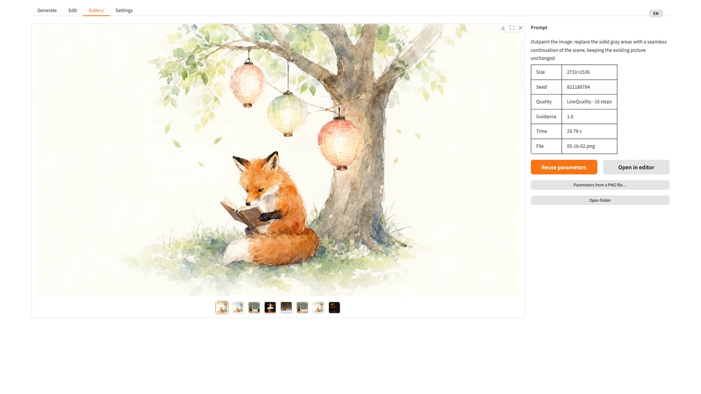

### Settings

This tab holds the language model address, the system prompts used by AI boost,
the **performance** choices and a GPU memory report. *Model precision* and
*Memory profile* are lists in which every option states its video memory and
the cards it is for; the precision that fits your card is marked, and *Auto*
says what it becomes on your card. The access token is write-only: the page never shows it.

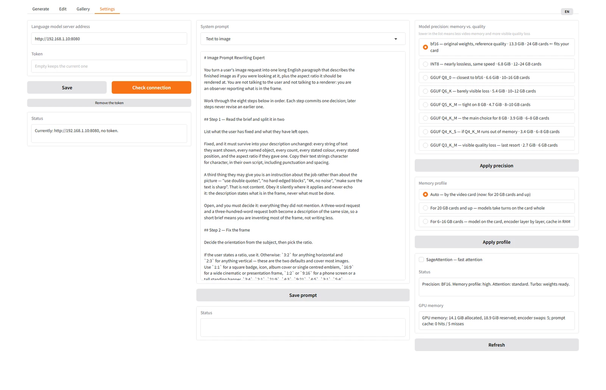

## Requirements

| | Minimum | Tested on |
|---|---|---|
| GPU | NVIDIA, 24 GB VRAM — "high" profile; **8 GB** — "low" profile with GGUF | RTX 3090, 24 GB; RTX 4060 Laptop, 8 GB |
| RAM | 64 GB for "high"; 16–24 GB for "low" | 128 GB; 24 GB |
| Disk | ~35 GB for the model weights (+13 GB for "low") | |
| OS | Windows 11; Linux via `install.sh` / `run.sh` (not tested on this build) | Windows 11 |
| Python | 3.12 (3.13 works) | 3.12 |
| Video (optional) | 8 GB VRAM, 16 GB RAM, NVIDIA driver 580+, ~80 GB of disk for the FreeVideo engine | RTX 3090, 24 GB |

The large RAM requirement is deliberate. A pinned copy of the text encoder
lives in RAM, so the diffusion transformer can stay resident on the GPU. The
weights then don't cross the PCIe bus on every generation (see
[docs/ARCHITECTURE.md](docs/ARCHITECTURE.md), section 3). If RAM is short, run
with `--no-pin-memory`. Cards under 20 GB get the "low" profile automatically —
see [Cards with 6–16 GB](#cards-with-616-gb).

## Which settings for my card

The installer looks at your card and proposes the precision from this table;
the memory profile stays on *Auto*. Everything can be changed later on the
Settings tab.

| Video memory | Precision (installer default) | Memory profile (*Auto*) | Start with |
|---|---|---|---|
| 20 GB and more | bf16 (INT8 frees 6.5 GiB for references) | high | Qwen Turbo HD, Medium |
| 12–20 GB | INT8 | low | Qwen Turbo, Low, Turbo |
| 10–12 GB | GGUF Q8_0 | low | Qwen Turbo, Low, Turbo |
| 8 GB | GGUF Q4_K_M | low | Qwen Turbo, Turbo4, Low |
| 6 GB (not tested) | GGUF Q4_K_S or Q3_K_M | low | Draft, Turbo |

Tested on an RTX 3090 (24 GB) and an RTX 4060 Laptop (8 GB); the rows in
between follow from the measured weight of each variant.

## Installation

Windows, from the project root:

```powershell
.\install.ps1
.\run.ps1
```

Linux:

```bash
./install.sh
./run.sh
```

The installer:

1. creates `.venv` with Python 3.12;
2. installs `torch`/`torchvision` from the PyTorch CUDA index, then the rest of `requirements.txt`;
3. checks that `torch` really is a CUDA build — some packages quietly swap it for a CPU one;
4. **asks about performance**: transformer precision — bf16 (original, 13.3 GiB
   of VRAM), INT8 (6.8 GiB, nearly the same speed) or a GGUF variant (Q8_0 …
   Q3_K_M; Q4_K_M is 3.9 GiB, for 6–8 GB cards) — and whether to install
   SageAttention (15–25% faster; on Windows a prebuilt wheel plus
   `triton-windows` matching your torch). Press Enter for the precision that
   fits the detected card (bf16 on 24 GB, Q4_K_M on 8 GB);
5. **downloads the model weights** (`Qwen/Qwen-Image-2.1`) into `Qwen-Image-2.1/`:
   ~33 GB for bf16; for INT8 the bf16 transformer shards are skipped and the
   INT8 transformer (7.3 GB, `unsloth/Qwen-Image-2.1-FP8`) goes to
   `Qwen-Image-2.1-INT8/`, ~26 GB in total. It checks the files listed in the
   model's index, resumes an interrupted download and skips what is already
   there. For GGUF the variant file (`unsloth/Qwen-Image-2.1-GGUF`) goes to
   `Qwen-Image-2.1-GGUF/`. On cards under 20 GB the INT8 copy of the text
   encoder is built here once (`Qwen-Image-2.1-TE-INT8/`, 8.4 GiB, about
   20 s). The pose recognition weights (DWPose, 350 MB) go to `DWPose/` in the
   same step. Extras download on first use instead, with a progress line: the
   Turbo adapter, the Qwen Turbo and Turbo4 transformers and the outpaint LoRA (159 MB,
   `Qwen-Image-2.1-outpaint/`). If a chosen precision needs a package the
   environment lacks (GGUF needs `gguf`), it is installed from
   `requirements.txt` before the weights;
6. **asks for the language model address and token** for AI boost and tests
   the connection. Press Enter to skip: everything except AI boost and
   *Describe image* works without it;
7. runs a self-test of the environment.

Useful commands:

```powershell
.\install.ps1 -Recreate                                  # rebuild .venv from scratch
.venv\Scripts\python -m fooocus_qwen --selftest          # check the environment
.venv\Scripts\python -m fooocus_qwen --fetch-model       # download / complete the weights
.venv\Scripts\python -m fooocus_qwen --setup-llm         # set the language model again
.venv\Scripts\python -m fooocus_qwen --setup-performance # choose precision and SageAttention again
```

## Running

`run.ps1` starts the server on `0.0.0.0:7865`, so other machines on your
network can reach it too. It opens `http://127.0.0.1:7865` in your browser as
soon as the page can be served. The model loads in the background while you
type the first prompt (about 30 seconds).

Arguments are passed through to the application:

```powershell
.\run.ps1 --lang ru --port 7870 --preset LowQuality
```

| Flag | Meaning |
|---|---|
| `--host`, `--port` | listen address (default `0.0.0.0:7865`) |
| `--lang en\|ru` | interface language at start (default `en`; switch any time with the EN/RU button) |
| `--preset LowQuality\|MiddleQuality\|MaxQuality\|Turbo\|TurboDraft\|Turbo4\|QwenTurbo\|QwenTurboHD\|QwenTurbo2K` | default quality preset |
| `--lora-dir PATH` | folder with LoRA files (default `loras/`; point it at your ComfyUI loras folder) |
| `--no-open-browser` | don't open the browser |
| `--no-preload` | load the model on first use instead of at start |
| `--no-pin-memory` | don't pin the text encoder in RAM (saves 16+ GB, slower model swaps) |
| `--verbose` | detailed log |
| `--prompt "…" --out file.png` | one generation without the interface |
| `--api` (or `-api`) | serve only the HTTP API, without the interface — see [docs/API.md](docs/API.md) |
| `--api-token TOKEN` | Bearer token the API requires (or the `FOOOCUS_QWEN_API_TOKEN` environment variable) |
| `--username NAME --password PASS` | ask for a login before the interface opens (the password can come from `FOOOCUS_QWEN_PASSWORD`) |
| `--selftest` | check the environment and exit |

### HTTP API

```powershell
.\run.ps1 --api --api-token "a-long-random-string"
```

starts only the API: `POST /api/v1/generate`, `/edit`, `/outpaint`, poses,
AI boost, the gallery, saved prompts and settings, with interactive docs at
`http://127.0.0.1:7865/docs`. Requests wait for the result by default; with
`?wait=false` they return a job whose progress you can poll. The reference
with examples is [docs/API.md](docs/API.md).

## Usage guide

The full guide is in Russian: [docs/USAGE.md](docs/USAGE.md). The essentials follow.

### Quality presets

The interface names the presets by what they give; the names in brackets
are what `--preset`, saved prompts and the PNG parameters use.

| In the interface | Resolution | Steps | RTX 3090 | RTX 4060 Laptop 8 GB |
|---|---|---|---|---|
| **Draft** (TurboDraft) | 768 px | 6 | ~5 s | 18.8 s |
| **Turbo** | 1024 px | 6 | ~11 s | 31.9 s |
| **Qwen Turbo** (QwenTurbo) | 1024 px | 8 | 10–13 s | |
| **Turbo4** | 1024 px | 4 | | 19.3 s* |
| **Qwen Turbo HD** (QwenTurboHD) | 1536 px | 8 | ~25 s | |
| **Qwen Turbo 2K** (QwenTurbo2K) | 2048 px | 8 | ~49 s | |
| Low (LowQuality) | 1024 px | 16 | ~21 s | 66.5 s |
| Medium (MiddleQuality) | 1536 px | 28 | ~93 s | 215.4 s |
| Maximum, 2K (MaxQuality) | 2048 px | 40 | ~283 s | |

<sub>RTX 3090 column: bf16 with standard attention; Draft — INT8 with
SageAttention; the Qwen Turbo rows — bf16 with SageAttention (Medium with
SageAttention: ~77 s). * Turbo4 against Turbo on the same laptop: 19.3 s and
28.7 s for a cached prompt.</sub>

**Qwen Turbo, Qwen Turbo HD, Qwen Turbo 2K** run
[Qwen-Image-2.1-Turbo](https://huggingface.co/Qwen/Qwen-Image-2.1-Turbo), the
official fast checkpoint from Qwen: 8 steps, no CFG, its own schedule. Unlike
the Viggle LoRA it stays clean at any size — the 8-pixel grid at 1536 and
2048 px is at the level of the full model — so it is the fast way to a large
picture: HD is three times faster than Medium (25 s against 77 s, both with
SageAttention), 2K takes under a minute against ~4.7 minutes for Maximum.
Only its transformer differs from the main model (the text encoder
and VAE were checked tensor by tensor), so only the transformer is
downloaded on first use, matching your precision: the bf16 checkpoint
(13.6 GB) on bf16, a GGUF of the same level
([Abiray](https://huggingface.co/Abiray/Qwen-Image-2.1-Turbo-GGUF), 3–7 GB)
on GGUF, Q8_0 on INT8 — so it runs on 8 GB cards too. Switching to it and
back swaps the transformer (on 24 GB the main one waits in RAM). It edits,
outpaints and takes your LoRA; prompt following in edits is weaker than the
full model's. Negative prompt and guidance are ignored, as in every turbo
preset. Details: [docs/research/2026-10-10-qwen-turbo.md](docs/research/2026-10-10-qwen-turbo.md) (in Russian).

**Turbo** uses [Qwen-Image-2.1-viggle-turbo](https://huggingface.co/Viggle/Qwen-Image-2.1-viggle-turbo),
a distilled LoRA for this model: 6 steps without CFG instead of 16–40, for
generation and editing. It stays at 1 megapixel, the area it was distilled at:
above it the distilled model draws a fine 8-pixel grid, the same with bf16,
INT8 and SageAttention and in the authors' own reference code, so Turbo is a
fast 1 MP preset rather than a faster MiddleQuality. The adapter (1.3 GB) downloads the first
time you pick the preset. Negative prompt and guidance are ignored in Turbo.
Its authors have not validated mask editing and transparent (RGBA) output.

**TurboDraft** is the same distilled model at 768 px: about 1.8× faster than
Turbo (5.4 s vs 9.8 s on an RTX 3090 with INT8 and SageAttention) and clean
at full size. Use it to try prompts and seeds, then repeat the one you like
on Turbo or MiddleQuality with the same seed. (Suggested by a Reddit
commenter; 896 px was measured too and barely helps: 8.3 s.)

**Turbo4** is Viggle's 4-step distillate (preview v0.1) merged into the
transformer and quantized to GGUF Q4_K_M
([Abiray](https://huggingface.co/Abiray/Qwen-Image-2.1-viggle-4-steps-turbo-GGUF)).
The fastest preset: 19.3 s a frame on an RTX 4060 Laptop against 28.7 s for
Turbo. Rendered text holds up as well as Turbo, the look is more contrasty;
**editing is weaker** — the frame drifts from the source, so use Turbo for
edits. It is a separate transformer (4.2 GB, downloaded on first use), so
switching to Turbo4 and back swaps the transformer: about 4 s on 8 GB; on
24 GB the main one waits in RAM.

### Speed and memory: precision and SageAttention

On the Settings tab, under *Model precision* (lower in the list means less
video memory and more visible quality loss):

- **bf16** — the original weights, 13.3 GiB of VRAM;
- **INT8** — [Unsloth's INT8 weights](https://huggingface.co/unsloth/Qwen-Image-2.1-FP8)
  loaded weight-only: 6.8 GiB resident instead of 13.3, about 5% slower.
  Unsloth measured LPIPS 0.064 against bf16. It frees memory for the denoising
  phase — where references run out of it — and for other programs; while a
  new prompt is encoded the text encoder (16.3 GiB) is on the card in both
  modes, so that brief peak does not change.

- **GGUF Q8_0 … Q3_K_M** — [Unsloth's GGUF weights](https://huggingface.co/unsloth/Qwen-Image-2.1-GGUF),
  6.6 down to 2.7 GiB; Q4_K_M (3.9 GiB) is the choice for 6–8 GB cards,
  Q4_K_S a fallback if memory runs out, Q3_K_M a last resort with visible loss.

**Precision applies to every preset**, not to one model: the preset picks
which transformer runs and how many steps, the precision picks the form
its weights take.

| Precision | Low / Medium / Maximum, Turbo, Draft | Qwen Turbo, HD, 2K | Turbo4 |
|---|---|---|---|
| bf16 | main model, bf16 | Qwen's bf16 checkpoint | always GGUF Q4_K_M |
| INT8 | main model, INT8 | GGUF Q8_0 (no official INT8; Q8_0 is as large and nearly lossless) | always GGUF Q4_K_M |
| GGUF Qx | main model, same variant | same variant | always GGUF Q4_K_M |

Turbo and Draft are an adapter on top of the main model, so they follow its
precision. The Qwen Turbo transformer has the main model's architecture, so
the memory figures above hold for it as well; text encoder and VAE are
shared. To compare presets fairly keep one precision: on bf16 both sides
run on the original weights.

*Apply precision* downloads the missing weights (with a progress bar) and
reloads the model. **SageAttention** switches on the fly; the checkbox is
active only when the package is installed (choose it in `install.ps1`). On an
RTX 3090 it makes a step 15–25% faster at 1536 px and above.

### Image formats

Any cell, the edit brush and the pose photo take more than PNG and JPEG — drop
or pick the file as is:

| Kind | Formats |
|---|---|
| Phone photos | **HEIC / HEIF** (iPhone, Android), AVIF |
| Camera RAW | DNG, CR2, CR3, CRW, NEF, NRW, ARW, SRF, SR2, RAF, ORF, RW2, PEF, SRW, X3F, 3FR, IIQ and other LibRaw formats |
| Editors and print | TIFF (8/16 bit, CMYK), PSD (flattened image), TGA, JPEG 2000, JPEG XL |
| Rendering | EXR, Radiance HDR, PFM — linear light shown as at exposure 0 |
| Web and icons | PNG, JPEG, WebP, GIF (first frame), BMP, ICO (largest size), ICNS, SVG |
| Other | QOI, DDS, PCX, PNM, SGI, Sun Raster, XBM/XPM |

Formats the browser cannot show are converted to PNG on the server (SVG is
rasterized in the browser at 2048 px on the long side) before the field ever
sees them, a status line says so meanwhile. EXIF orientation is applied,
colour profiles (Display P3 of iPhone photos, CMYK) are converted to sRGB,
16-bit and float images become 8-bit, transparency is kept. A file that is
not an image gets a message, not silence. The same formats are accepted by
the API as base64. Decoders: Pillow, `pillow-heif`, `pillow-jxl-plugin`,
`rawpy` (LibRaw), `OpenEXR`, OpenCV — all from `requirements.txt`.
`install.ps1` / `install.sh` install them; an environment built before
this feature and updated with `git pull` needs them once:
`.venv\Scripts\python -m pip install -r requirements.txt` (or rerun the
installer). Until then the startup log and `--selftest` name the missing
packages, and only their formats are refused.

### Reference images

References live in a grid of ten cells to the left of the result on the
Generate tab — two columns of five, as tall as the result, empty by default. Click a cell to pick a
file or drop an image onto it; the cross in a cell's corner clears it, and
**Clear references** under the grid empties them all.

Each filled cell is labelled with its tag. With two or more references, the
prompt must refer to them as `<image1>`, `<image2>`, … — the model does not
understand “the first photo”. Tags follow the order of the **filled** cells,
not the cell number: empty cells are not sent to the model, so cells 1, 3
and 7 are `<image1>`, `<image2>` and `<image3>`. With exactly one reference,
don't use a tag at all.

**Poses.** The figure icon on a cell opens the pose library: the 46 poses of
[openposes.com](https://openposes.com/) (model: Emma Watson), then your own.
Clicking a tile puts its skeleton into the cell. The catalogue ships with the
project in `resources/poses/catalog/`; `tools\fetch_poses.py` refreshes it
from the site.

The last tile, **Add a pose**, takes a photo of a person. The pose is
recognised on the CPU in a fraction of a second with
[DWPose](https://github.com/IDEA-Research/DWPose) (its 350 MB of ONNX weights
are downloaded by the installer), the skeleton goes into the cell at once, and
the pose is saved to `user/outputs/poses/`, next to your generations. Qwen-Image then draws a tile for it in the
catalogue's style (about 25 s with Turbo if its adapter is already downloaded,
LowQuality otherwise). Give the pose a name in the field above the photo, or
it becomes "My pose N".

Each tile shows the pose's name. The pencil in a tile's corner opens its
editor: rename it, redraw its cover with Qwen-Image, or tick **Schematic view**
to show the bare skeleton when the cover came out wrong. **Delete pose** removes
your own pose from the disk; a catalogue pose is only hidden
(`user/outputs/poses/meta/hidden.json`). Edits to catalogue
poses are stored with your data (`user/outputs/poses/meta/`), on top of the
catalogue, which itself stays unchanged.

**Sketches.** The pencil icon opens a white canvas with the same brush as the Edit tab:
palette plus a custom colour picker, brush opacity, size, eraser, undo/redo,
zoom. A translucent stroke lays down evenly, even where it crosses itself. **Accept** puts the drawing into the
cell, **Cancel** closes the window.

More references use more memory. **Reference detail** (under Advanced) sets
the resolution the references are scaled to; *Auto* picks it from the number
of condition images and says so in the status line. At full detail, five
references at 1536 px overflow a 24 GB card and a frame takes minutes instead
of seconds.

### LoRA

Put `*.safetensors` files into `loras/` in the project root, or start with
`--lora-dir` pointing at an existing folder (subfolders show as `a/b`).
Five slots sit under **LoRA** on the Generate and Edit tabs: tick, file,
weight from −2 to 2. Picking a file ticks its slot; *Refresh list* rereads
the folder.

Only LoRA made for **Qwen-Image 2.1** fit. The 2.1 transformer is a
different architecture from Qwen-Image 1 / 2512 / Edit (32 single-stream
blocks, width 4096, SwiGLU MLP), so their LoRA are refused with a note under
the slot, and the status line names any LoRA skipped at generation.
Supported formats: diffusers/peft (alpha from the file metadata),
DiffSynth/ModelScope, ComfyUI and ai-toolkit (the fused `img_mlp.gate_up` is
split into `gate_layer` and `proj`), kohya. DoRA, LoKr, LoHa and full weight
diffs are not supported.

LoRA stay separate from the weights (not fused), so weights change without
reloading: one LoRA costs about 7% per Turbo frame on an RTX 3090, two about
10%; attaching a file takes 1–2 s once. Style LoRA work with Turbo; speed-up
LoRA (Pruna, Lightning) on top of Turbo do not stack. Trigger words are
shown under the slot but not added to the prompt. Details:
[docs/research/2026-10-02-lora.md](docs/research/2026-10-02-lora.md) (in Russian).

### Editing

The Edit tab changes an image by instruction. The prompt is required: it says
what to change. The region mode decides where the change goes:

| Mode | What you paint | What happens |
|---|---|---|
| **Mask** (default) | the area to change | only the masked area changes; pixels outside are kept exactly |
| **Annotation** | several areas in different colours | the colours become part of the image; refer to them in the prompt (“the red circle…”) |
| **Exact region** | a small area on a large image | a crop around the mask is edited at full detail and pasted back |
| **No region** | nothing | the whole frame is edited |

The Edit tab has its own reference grid to the left of the brush, with the
same pose and sketch tools: “put the cat from `<image3>` into the marked
area”. There `<image1>` is the image being edited; in Mask and Exact region
modes `<image2>` is the mask, so references start at `<image3>` (at
`<image2>` in the other modes). The cell labels follow the region mode, and
if the mask turns out empty the status line says where the tags moved.

*Mask grow* and *Feather* (under Advanced) widen the mask and soften the
paste seam. The model itself always receives a hard black-and-white mask: it
reads a grey edge as “make this transparent”.

### The mask brush

| Action | Mouse | Keyboard |
|---|---|---|
| brush / eraser | toolbar; the right mouse button always erases | B / E; X toggles |
| brush size | slider, Shift + wheel | `[` and `]` |
| undo / redo | toolbar | Ctrl+Z / Ctrl+Y |
| zoom to cursor | wheel | — |
| pan | middle button, or Space + drag | — |
| fit to view | toolbar | F or 0 |
| show / hide marks | eye button | H |
| invert / clear marks | toolbar | — |
| crop the picture | crop button: drag the frame, its corners or edges, pick proportions, ✓ or double-click | C, Enter, Esc; Ctrl+Z restores the original |

Load an image by dropping it on the brush, with the **+** button, with
**Ctrl+V** while the pointer is over the canvas, or with **Open in editor** in
the gallery. On a touch screen, draw with one finger; pinch and drag with two.

### Outpainting

Open **Outpaint**, choose a target aspect ratio — the picture grows to it,
centred — or the sides and how far, and press **Extend**. There is no mask to
paint and no second button: the new area is filled in one pass.

How it works: the picture is placed on a canvas whose new area is flat gray,
the whole canvas goes to the model as the image to edit (a mask would leave a
visible box at the seam on Qwen 2.1), and
[AusBoss's outpaint LoRA](https://huggingface.co/ausboss/Qwen-Image-2.1-Outpaint-LoRA)
(159 MB, downloaded on first use) keeps the picture in place while the gray is
painted over. The original is then pasted back at its own resolution with a
32 px feather and a tone match. Without the LoRA the model often reframes the
picture (19–29 dB PSNR of the kept area against 30–40 dB with it, measured
here), and the paste-back shows a seam.

The prompt is optional: words there are added as what belongs in the new
area. With **AI boost** on, a language model describes the scene first,
which makes the continuation more faithful. Extend by at most the picture's
own size per side at once — beyond that a second scene can appear; for more,
**Send to editor** and extend again. Works with every preset, Turbo
included, and with your own LoRA. Details:
[docs/research/2026-10-02-outpaint.md](docs/research/2026-10-02-outpaint.md) (in Russian).

### Video

The Video tab runs [FreeVideo](https://github.com/FlashML-org/FreeVideo)
(Apache-2.0), an inference engine for MiniMax H3 built for small cards:
int8 ConvRot weights, asynchronous block offload with pinned memory,
precomputed AdaLN tables instead of 26 GB of projections, a tiled VAE and
two-pass sampling (8 + 3 steps). It needs a Python environment of its own
(torch 2.13), so it lives in the `FreeVideo/` folder and runs as a separate
process; the image model is unloaded while a video renders.

Install it with step 7 of the installer, with
`python -m fooocus_qwen --setup-video`, or with the button on the Video tab.
If you already have H3 weights (for example in ComfyUI), add
`--video-reuse-models <folder>` and matching files are hard-linked instead of
downloaded. The weights are covered by the MiniMax H3 Community License;
setup accepts it on your behalf, so read it first. Details:
[docs/USAGE.md](docs/USAGE.md), section 14, and
[docs/research/2026-10-19-video-freevideo.md](docs/research/2026-10-19-video-freevideo.md).

### AI boost

Set the address of an OpenAI-compatible server during installation or on the
Settings tab. With **AI boost** on, the prompt is rewritten before
generation. If the language model can't read images, the edit rewrite falls
back to the text alone and says so. Rewritten descriptions are in English
unless the instruction is in Chinese. Text you want drawn in the image — in
double quotes — keeps its own language.

### Cards with 6–16 GB

This is an **extension**: on 20 GB cards and up nothing changes. The *Memory
profile* on the Settings tab:

- **Auto** (default) — "high" from 20 GiB of VRAM, "low" below;
- **High** — the transformer and the bf16 text encoder take turns on the card (24 GB);
- **Low** — the transformer stays on the card; the text encoder (compressed to
  INT8, as accurate as bf16) is lifted onto the card one layer at a time; the
  large KV cache of edits and references lives in RAM; smaller VAE tiles.
  Turbo uses the same distillate with a lighter adapter (0.63 GB).

For 8 GB use GGUF Q4_K_M with *Auto*. Start with LowQuality (1024 px) or
Turbo; MiddleQuality (1536 px) works but takes about four minutes a frame.
Close programs that hold VRAM (a browser with hardware acceleration, games).
If memory runs out — Q4_K_S, then fewer references. Analysis and
measurements: [docs/research/2026-10-02-8-gb.md](docs/research/2026-10-02-8-gb.md)
(in Russian).

## Performance

Measured on an RTX 3090 (24 GB); median of steady-state runs:

| | Time | Peak VRAM |
|---|---|---|
| LowQuality, 1024 px | 21.5 s | 17.0 GiB |
| MiddleQuality, 1536 px | 93.0 s | 15.2 GiB |
| MaxQuality, 2048 px | 283.5 s | 16.2 GiB |
| MiddleQuality + 1 reference | 123.9 s | 21.0 GiB |
| Turbo, 1280×832 | 10.4 s | 16.8 GiB |
| Turbo + SageAttention on INT8, 1280×832 | 10.0 s | **10.4 GiB** |
| Qwen Turbo HD + SageAttention, 1536 px | ~25 s | |
| Qwen Turbo 2K + SageAttention, 2048 px | ~49 s | |
| Model load | 33.8 s | |

Turbo figures are for a cached prompt; a new prompt adds ~1.5 s and a 17 GiB
peak while the text encoder runs. The details are in [docs/research/2026-09-24-uskorenie-turbo-sage-int8.md](docs/research/2026-09-24-uskorenie-turbo-sage-int8.md)
(in Russian).

The compute is close to the card's limit: 53.8 of 71.5 TFLOPS. Full numbers
and methodology: [docs/BENCHMARK.md](docs/BENCHMARK.md).

RTX 4060 Laptop (8 GB), GGUF Q4_K_M + SageAttention, "low" profile:

| | Time | Peak VRAM |
|---|---|---|
| LowQuality, 1024 px | 66.5 s | 5.5 GiB |
| 1024 px, 25 steps | 97.1 s | 5.6 GiB |
| Turbo, 1024 px | 31.9 s | 6.2 GiB |
| TurboDraft, 768 px | 18.8 s | 6.2 GiB |
| Edit, 1024 px | 77.6 s | 6.4 GiB |
| Two references | 79.6 s | 6.5 GiB |
| MiddleQuality, 1536 px | 215.4 s | 6.5 GiB |
| Model load | 8 s | |

Times include encoding a new prompt; repeating the same prompt is 2–4 s shorter.

## Privacy and security

- **No telemetry.** Generation is local, and Gradio analytics and its version
  check are switched off. The only outgoing requests go to your own language
  model server, and only when you use AI boost or *Describe image*.
- **The language model token never reaches the browser.** The interface
  listens on your local network, so the Settings tab treats the token as
  write-only. The token is also kept out of logs.
- **Your data stays out of the repository.** `llm_endpoint.txt` (address and
  token), `user/` (images and saved prompts), `logs/` and `tmp/` are all
  git-ignored.
- **Paths from the browser are not trusted**: the mask brush only accepts
  image paths inside Gradio's upload folder.
- **Access control is opt-in.** The interface listens on your whole network
  by default; `--username`/`--password` put a login in front of it, and the
  API (`--api`) takes a Bearer token (`--api-token`). Both secrets can come
  from environment variables instead of the command line, and neither is
  written to the log. Beyond your local network, add HTTPS with a reverse
  proxy. The API serves files only from the outputs folder.

## Project layout

```
fooocus_qwen/
  engine/      pipeline loading, generation, GPU residency, embedding cache, tiled VAE
  imaging/     masks, outpaint planning, aspect ratios, PNG metadata
  prompting/   AI boost, styles, saved prompts
  llm/         OpenAI-compatible client, endpoint file, installer dialogue
  storage/     output folders by date
  video/       MiniMax H3 video: frame grid, H3 prompts, storyboard, ffmpeg joining, the FreeVideo driver
  poses/       OpenPose skeletons, pose recognition (DWPose), the pose library, pose tiles
  ui/          Gradio tabs, the mask brush (ui/painter/), reference tools, layout, translations
  api/         the HTTP API (--api): FastAPI routes, job queue, Bearer token
resources/     Fooocus styles, the Qwen system prompts, default saved prompts, the "Add a pose" tile
loras/         your LoRA files (git-ignored; --lora-dir points elsewhere; loras/video for H3)
FreeVideo/     the video engine: its own clone, environment and weights (git-ignored, --setup-video)
tools/         smoke test, benchmark, UI check, screenshot builder, experiments
docs/          architecture, usage guide, benchmark, research notes (in Russian)
tests/         unit tests (no GPU needed)
```

## Development

```powershell
.venv\Scripts\python -m pip install -r requirements-dev.txt
.venv\Scripts\python -m playwright install chromium

.venv\Scripts\python -m pytest -q                 # 1300+ unit tests, no GPU needed
.venv\Scripts\python -m ruff check .              # lint, rules in ruff.toml
.venv\Scripts\python tools\ui_check.py            # the interface in a real browser, fake generator
.venv\Scripts\python tools\smoke.py               # end-to-end run with the real model
.venv\Scripts\python tools\docs_screenshots.py --phase showcase   # README images with the real model,
.venv\Scripts\python tools\docs_screenshots.py --phase ui         # then the interface screenshots
```

- `tools/ui_check.py` starts the interface exactly as `run.ps1` does, with a
  fake generator in place of the model. In Chromium it checks the layout at
  six window sizes, language switching, where the mask lands in the frame,
  brush latency, the gallery and that the token never appears on the page.
- `tools/docs_screenshots.py` rebuilds every image in this README from a live
  run. Its temporary files go to `tmp/`.
- The documentation in `docs/` is in Russian. [docs/ARCHITECTURE.md](docs/ARCHITECTURE.md)
  explains the design decisions; `docs/research/` has the measurements behind
  them.

## License

The code is released under the [MIT License](LICENSE).

The Qwen-Image-2.1 **model weights are licensed separately** under the
[Qwen Research License Agreement](https://huggingface.co/Qwen/Qwen-Image-2.1),
which allows non-commercial use only — defined there as *research or
evaluation*. Commercial use requires a separate license from the model's
authors. The MIT license on this code does not lift those terms, and the
application does nothing without the weights. Read the model license before
using the application or the images it produces.

## Acknowledgements

- [Qwen-Image](https://github.com/QwenLM/Qwen-Image) by the Qwen team — the model and the official prompt-rewriting prompts.
- [Fooocus](https://github.com/lllyasviel/Fooocus) by lllyasviel — the interface philosophy and the style catalogue.
- [diffusers](https://github.com/huggingface/diffusers) and [Gradio](https://github.com/gradio-app/gradio).
- [MiniMax H3](https://huggingface.co/MiniMaxAI) by MiniMax — the video model; [OpenVDN](https://github.com/OpenVDN/vdn-minimax-h3) — its eight-step VDN-H3 distillation; [FreeVideo](https://github.com/FlashML-org/FreeVideo) by FlashML — the low-memory engine the Video tab runs.
